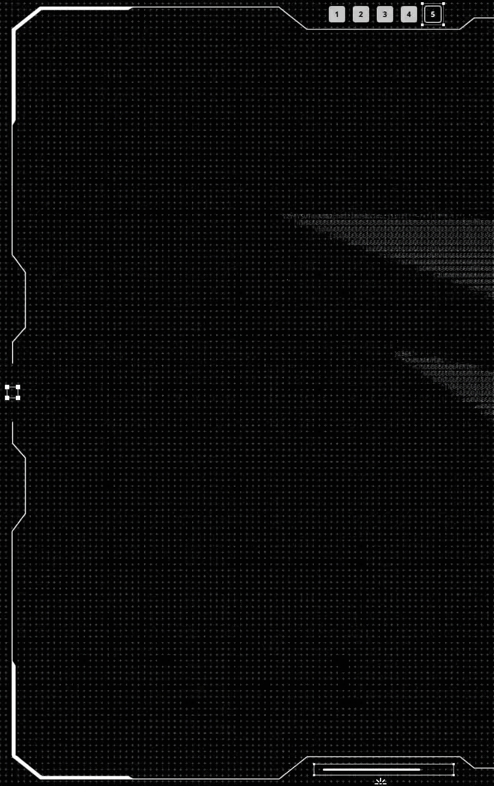
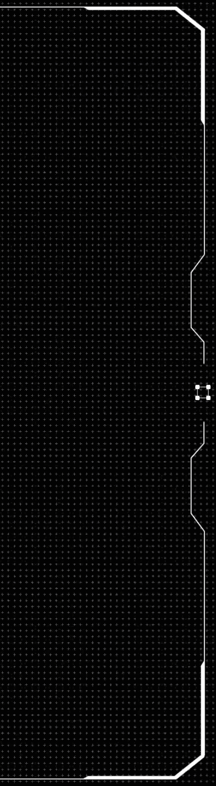
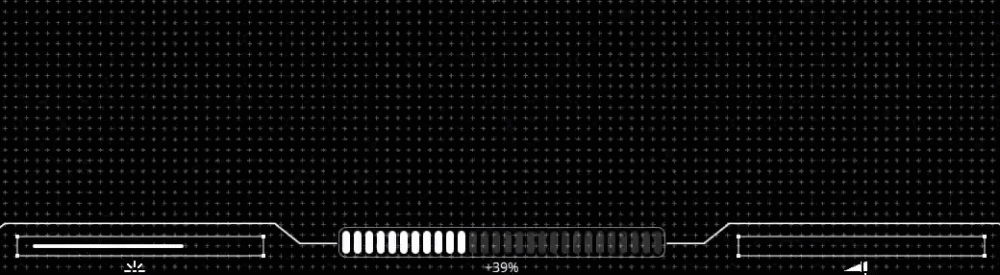
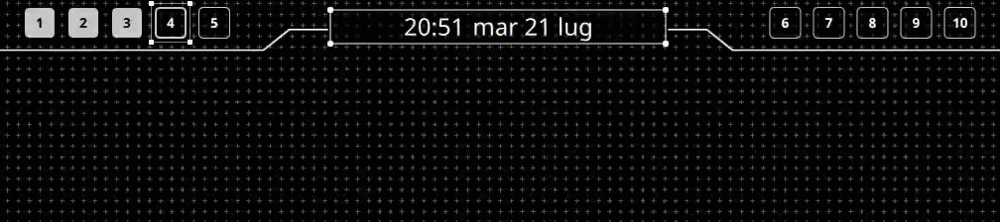
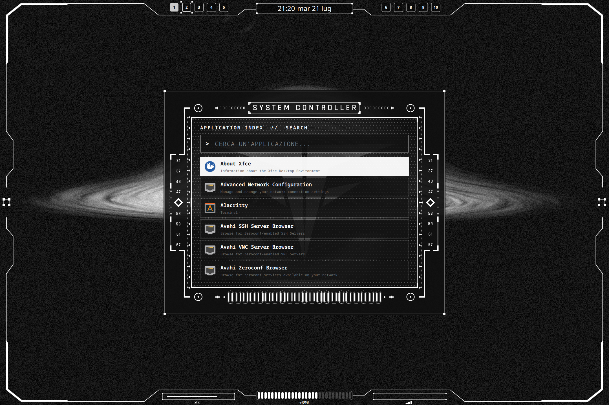

# Nihil HUD

A [Quickshell](https://quickshell.org/) configuration for Hyprland that builds a monochrome HUD interface: screen-edge frames, system indicators, workspaces, a GPT panel, session controls, and an application launcher.

The project is written in QML and uses Quickshell's reactive services directly.

## Table of Contents

- [Features](#features)
- [Dependencies](#dependencies)
- [Installation](#installation)
- [Hyprland Integration](#hyprland-integration)
- [Components](#components)
  - [Edge Layout](#edge-layout)
  - [GPT HUD](#gpt-hud)
  - [Lock HUD](#lock-hud)
  - [Battery, Volume, and Brightness HUD](#battery-volume-and-brightness-hud)
  - [Clock and Workspaces HUD](#clock-and-workspaces-hud)
  - [Launcher HUD](#launcher-hud)
- [Repository Structure](#repository-structure)
- [Customization](#customization)
- [Troubleshooting](#troubleshooting)

## Features

- Independent PNG frame on each of the four screen edges.
- Layer-shell panels that overlap windows without changing their layout.
- Animated GPT HUD connected to an external wrapper.
- Suspend, reboot, and shutdown controls.
- Battery status through UPower and volume status through PipeWire.
- Workspaces updated from Hyprland events.
- Brightness updated through a file watched by Quickshell.
- Application launcher with desktop-entry indexing, search, keyboard navigation, and application launching.

## Dependencies

### Required

| Dependency | Purpose |
| --- | --- |
| Quickshell | QML runtime and `PanelWindow` management |
| Hyprland | Compositor, layer-shell, workspace events, and global shortcuts |
| Qt 6 / QtQuick / QtQml | Interface components and animations |
| PipeWire + WirePlumber | Default audio sink status |
| UPower | Battery percentage and charging state |
| `brightnessctl` | Brightness increase and decrease |
| `pamixer` | Volume keys configured in `hyprland.conf` |
| PulseAudio tools (`pactl`) | Microphone toggle configured in `hyprland.conf` |
| Bash, GNU coreutils, and `awk` | Brightness helper scripts |

The Quickshell build must include these QML modules:

```text
Quickshell
Quickshell.Hyprland
Quickshell.Io
Quickshell.Services.Pipewire
Quickshell.Services.UPower
Quickshell.Wayland
Quickshell.Widgets
```

### Optional

| Dependency | Purpose |
| --- | --- |
| External ChatGPT wrapper | Window controlled by `ChatGPTHud.qml` through `--toggle` |
| `jq` | Only used by the legacy `scripts/battery.sh`; the HUD reads UPower directly |
| `grim`, `slurp`, `wl-copy` | Screenshot shortcuts available in the example Hyprland configuration |
| A monospace font | Launcher and indicator text |

Session buttons use `systemctl`, so a systemd-based system is required.

## Installation

Clone the repository into the path expected by `hyprland.conf`:

```bash
mkdir -p ~/.config/quickshell
git clone https://github.com/FrancescoFontanesi/nihil.git ~/.config/quickshell/nihil
chmod +x ~/.config/quickshell/nihil/scripts/*.sh
mkdir -p ~/.config/quickshell/nihil/tmp
```

Run it manually for the first check:

```bash
quickshell -p ~/.config/quickshell/nihil/
```

Before using the project on another system, update the absolute paths described in [Customization](#customization).

## Hyprland Integration

The following lines are currently used in `hyprland.conf`. In the original setup, the file is located at `~/.config/hypr/hyprland.conf`.

> Note: `hyprland.conf` is not included in this repository; the blocks below are ready to copy into your own configuration.

### Autostart

Lines 37 and 39 of the original file:

```ini
exec-once = quickshell -p ~/.config/quickshell/nihil/
exec-once = /home/nihil/Extra/Chatgpt-PyGObject/chatgpt-wrapper --background
```

The second line is only required for the GPT HUD and must be updated to match your wrapper location.

### Quickshell Global Shortcuts

Lines 178, 186, and 187 of the original file:

```ini
$mainMod = SUPER

bind = $mainMod, Escape, global, lock:toggle
bind = $mainMod, M, global, hud:toggle
bind = SUPER_L, SPACE, global, launcher:toggle
```

The format is `global, appid:name` and maps to the `GlobalShortcut` declarations in the QML components:

| Shortcut | Quickshell target | Component |
| --- | --- | --- |
| `SUPER + Escape` | `lock:toggle` | `modules/widgets/LockHud.qml` |
| `SUPER + M` | `hud:toggle` | `modules/widgets/ChatGPTHud.qml` |
| `SUPER + Space` | `launcher:toggle` | `modules/launcher/LauncherHud.qml` |

### GPT Wrapper Rules

Lines 193–195 of the original file:

```ini
windowrulev2 = float, class:^(chatgpt-wrapper)$
windowrulev2 = size 794 1286,, class:^(chatgpt-wrapper)$
windowrulev2 = move 78 74, class:^(chatgpt-wrapper)$
```

### Volume and Brightness

Lines 253–260 of the original file:

```ini
bind = ,122, exec, pamixer --decrease 5
bind = ,123, exec, pamixer --increase 5
bind = ,121, exec, pamixer --toggle-mute
bind = ,XF86AudioMicMute, exec, pactl set-source-mute @DEFAULT_SOURCE@ toggle

bind = ,232, exec, ~/.config/hypr/scripts/decrement_brightness.sh
bind = ,233, exec, ~/.config/hypr/scripts/increment_brightness.sh
```

The volume widget automatically detects changes through PipeWire. Brightness scripts must update `tmp/brightness_percent`; you can copy or symlink them into Hyprland's scripts directory:

```bash
mkdir -p ~/.config/hypr/scripts
ln -s ~/.config/quickshell/nihil/scripts/decrement_brightness.sh ~/.config/hypr/scripts/decrement_brightness.sh
ln -s ~/.config/quickshell/nihil/scripts/increment_brightness.sh ~/.config/hypr/scripts/increment_brightness.sh
```

## Components

### Edge Layout

Main files:

- `modules/layout/EdgeOverlayLayout.qml`
- `modules/layout/EdgeStrip.qml`
- `assets/top.png`, `assets/bottom.png`, `assets/left.png`, `assets/right.png`

`EdgeOverlayLayout` creates four `PanelWindow` instances, reserves the configured space with `exclusiveZone`, and draws PNGs along their corresponding edges. `EdgeStrip` applies the side-specific offset while keeping the window click-through.

#### Screenshot


### GPT HUD

Main files:

- `modules/widgets/ChatGPTHud.qml`

With `SUPER + M`, `ChatGPTHud` animates the left panel and invokes the wrapper configured in `shell.qml` with the `--toggle` argument. The panel closes when the workspace changes.

#### Screenshot




### Lock HUD

Main files:

- [LockHud.qml](modules/widgets/LockHud.qml)
- `modules/widgets/HudLockButton.qml`

`LockHud` is an independent session-control widget. `SUPER + Escape` opens the right-side HUD through `lock:toggle`, where the user can suspend, reboot, or shut down the system. The widget closes automatically when switching workspaces and returns to click-through mode when collapsed.

#### Screenshot



### Battery, Volume, and Brightness HUD

Main files:

- `modules/widgets/HudBattery.qml`
- `modules/widgets/HudVolumeBar.qml`
- `modules/widgets/HudbrightnessBar.qml`
- `scripts/increment_brightness.sh`
- `scripts/decrement_brightness.sh`

The three indicators are placed in the bottom bar:

- Battery reads percentage and power status directly from UPower.
- Volume watches the default sink through PipeWire and indicates mute state.
- Brightness watches `tmp/brightness_percent` through `FileView`, without keeping a `tail` process running.

#### Screenshot



### Clock and Workspaces HUD

Main files:

- `modules/widgets/HudClock.qml`
- `modules/widgets/HudWorkSpaces.qml`

The top bar shows time, date, and ten workspaces. The indicator distinguishes active and occupied workspaces; updates come from Hyprland events rather than periodic `hyprctl` processes.

#### Screenshot



### Launcher HUD

Main files:

- `modules/launcher/LauncherHud.qml`
- `assets/wofi.png`

`SUPER + Space` opens the launcher and immediately focuses the search field. Applications come from `DesktopEntries.applications`; results are sorted by relevance and launched through their desktop entry.

Available controls:

| Key | Action |
| --- | --- |
| Text input | Filters indexed applications |
| `↑` / `↓` | Changes selection |
| `Page Up` / `Page Down` | Scrolls one page |
| `Tab` / `Shift + Tab` | Selects the next or previous result |
| `Ctrl + N` / `Ctrl + P` | Selects the next or previous result |
| `Enter` | Launches the selected application |
| `Escape` | Closes the launcher |

#### Screenshot



## Repository Structure

```text
.
├── assets/                 # PNG frames and icons
├── docs/screenshots/       # Screenshots used by the README
├── modules/
│   ├── launcher/           # Application launcher
│   ├── layout/             # Windows and edge strips
│   └── widgets/            # HUDs and indicators
├── scripts/                # Brightness helpers and legacy battery script
├── shell.qml               # Quickshell entry point
└── README.md
```

## Customization

These values depend on the original system and should be reviewed after cloning:

- `shell.qml`: GPT wrapper path and `PanelWindow` geometry.
- `scripts/increment_brightness.sh` and `scripts/decrement_brightness.sh`: the `OUTFILE` variable and `BACKLIGHT` device class.
- `modules/widgets/HudBattery.qml`: UPower automatically selects the display device.
- `modules/layout/EdgeOverlayLayout.qml`: thickness, margins, and indicator positions.
- `modules/launcher/LauncherHud.qml`: dimensions, maximum result count, and background asset.

The included edge assets were designed for the original 2160 × 1440 layout; other resolutions may require geometry adjustments in `shell.qml` and `EdgeOverlayLayout.qml`.

## Troubleshooting

### Quickshell Does Not Start

```bash
quickshell -p ~/.config/quickshell/nihil/
```

Check the output and ensure that every QML module listed in the dependencies is available.

### A Shortcut Does Not Open a HUD

Check shortcut registration:

```bash
hyprctl globalshortcuts
```

`hud:toggle`, `lock:toggle`, and `launcher:toggle` should appear. After changing `hyprland.conf`, run `hyprctl reload`.

### The Launcher Does Not Receive Input

Check that `LauncherHud.qml` sets `WlrKeyboardFocus.Exclusive` while opening and that no conflicting focus grab is active.

### Brightness Does Not Update

Check the watched file:

```bash
cat ~/.config/quickshell/nihil/tmp/brightness_percent
```

If it does not exist, run one of the brightness scripts and check `BACKLIGHT` and `OUTFILE`.

### Runtime Logs

```bash
qs -p ~/.config/quickshell/nihil log --no-color
```
