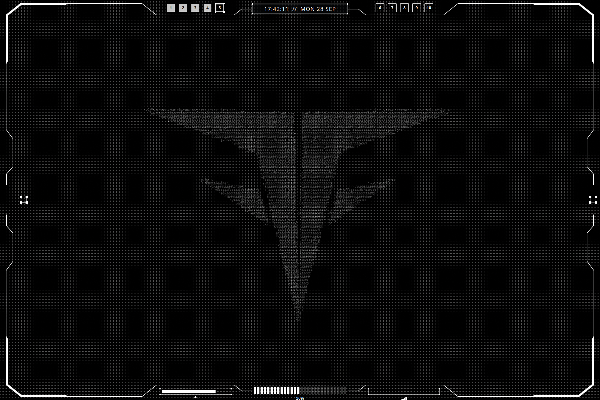
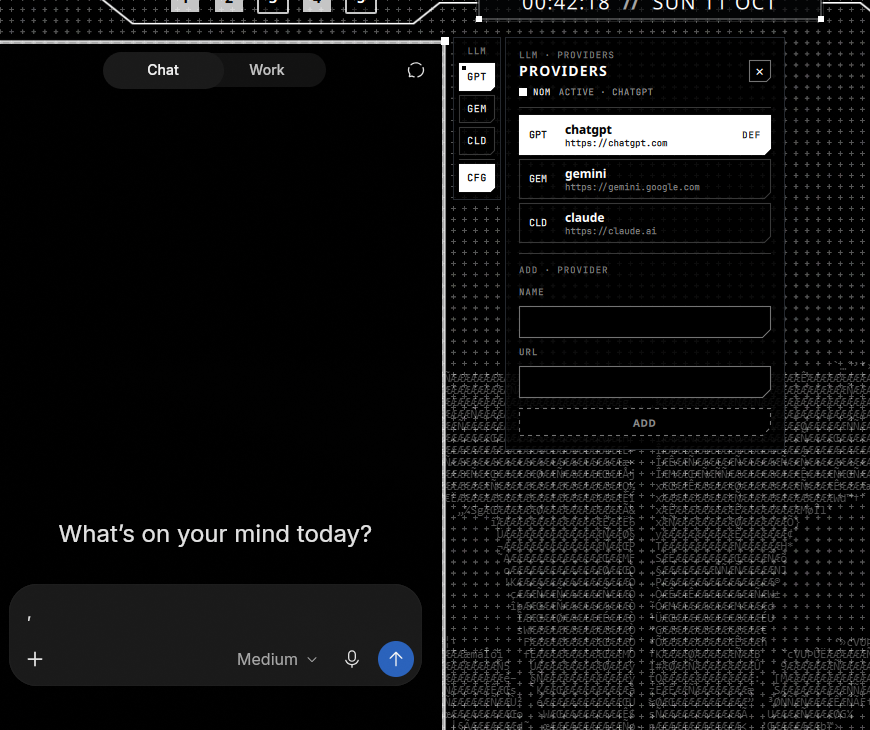
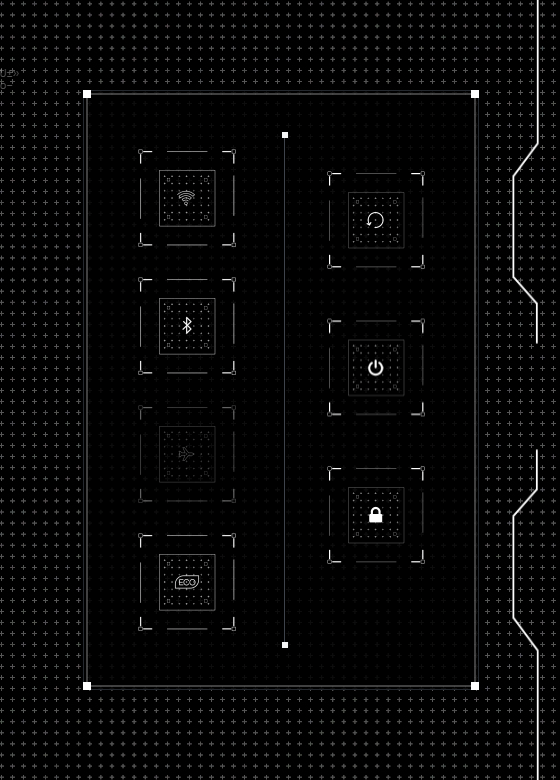
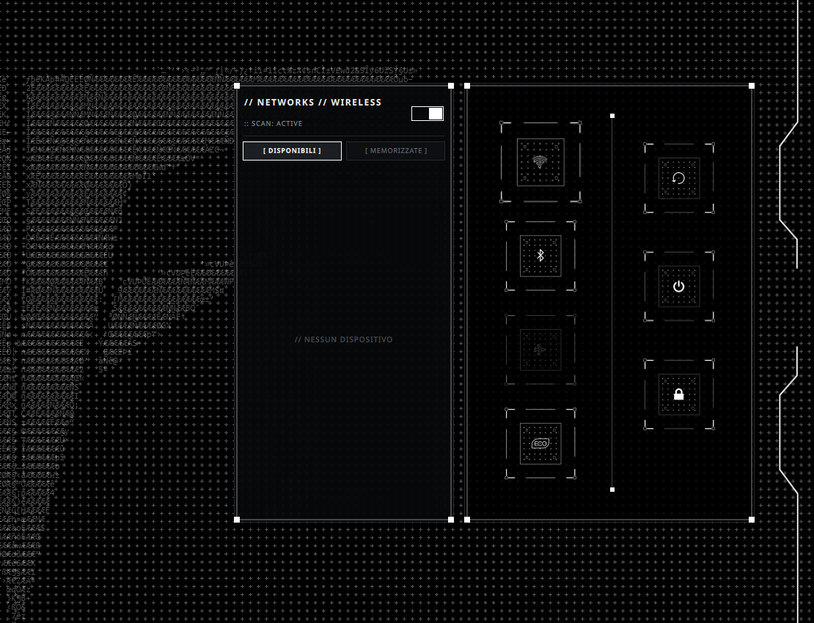
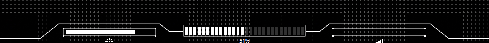
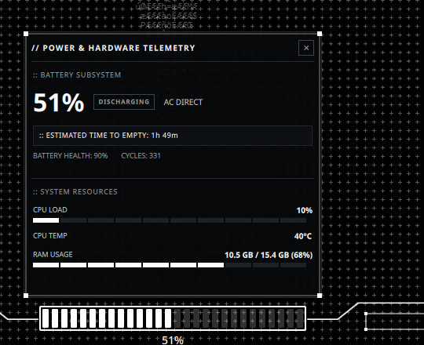
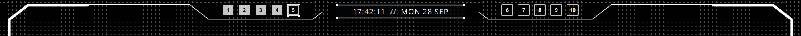
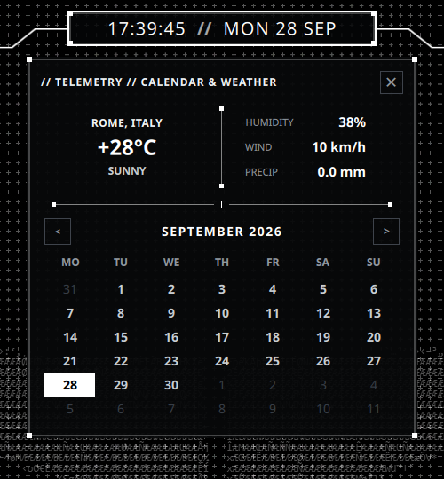
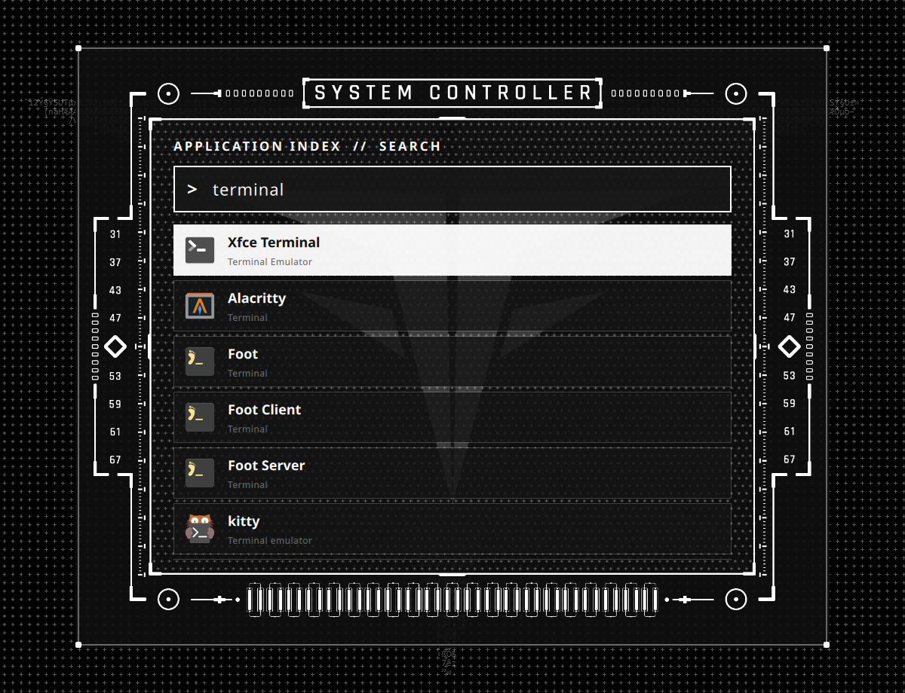

# Nihil HUD

A [Quickshell](https://quickshell.org/) shell for Hyprland: a monochrome desktop frame with live system indicators and animated overlay panels for the calendar, hardware telemetry, connectivity, session controls, an LLM companion with switchable providers, and application search.

The UI is written in QML. The edge bars stay on screen; interactive panels open over the desktop. The clock, battery, and session drawers close on an outside click. The screenshots below show the current interface on a 2160 × 1440 display.



## Table of Contents

- [At a Glance](#at-a-glance)
- [Dependencies](#dependencies)
- [Installation](#installation)
- [Hyprland Integration](#hyprland-integration)
- [Components](#components)
  - [Edge Layout](#edge-layout)
  - [LLM HUD](#llm-hud)
  - [Session and Connectivity HUD](#session-and-connectivity-hud)
  - [Battery, Volume, and Brightness HUD](#battery-volume-and-brightness-hud)
  - [Clock, Calendar, Weather, and Workspaces](#clock-calendar-weather-and-workspaces)
  - [Launcher HUD](#launcher-hud)
- [Repository Structure](#repository-structure)
- [Customization](#customization)
- [Troubleshooting](#troubleshooting)
- [License](#license)

## At a Glance

| Area | What it does |
| --- | --- |
| Four edges | Draws the PNG frame; top and bottom host the live widgets. |
| Top bar | Shows the clock/date and ten Hyprland workspaces. Click the clock for calendar and weather. |
| Bottom bar | Shows battery, default audio sink, and brightness. Click the battery for hardware telemetry. |
| Left overlay | Opens the LLM wrapper (ChatGPT, Gemini, Claude or any web chat) with `SUPER + M`; a side rail switches provider. |
| Right overlay | Opens session, Wi‑Fi, Bluetooth, airplane-mode, and power-profile controls with `SUPER + Escape`. |
| Center overlay | Searches and launches installed desktop applications with `SUPER + Space`. |

The drawers and session overlay are clickable without moving application windows. The status bars use Quickshell services and compositor events where available; the weather panel fetches data from `wttr.in` when opened.

## Dependencies

### Required

| Dependency | Purpose |
| --- | --- |
| Quickshell | QML runtime and `PanelWindow` management |
| Hyprland | Compositor, layer-shell, workspace events, and global shortcuts |
| Qt 6 / QtQuick / QtQml | Interface components and animations |
| PipeWire + WirePlumber | Default audio sink status |
| UPower | Battery percentage and charging state |
| `brightnessctl` | Brightness control and percentage readout |
| `udevadm` | Backlight change events for the brightness HUD |
| NetworkManager (`nmcli`) | Wi‑Fi state, scans, connections, and saved networks |
| BlueZ | Bluetooth power, discovery, pairing, and connections, through Quickshell's `Quickshell.Bluetooth` service over D-Bus |
| `rfkill` | Airplane-mode control |
| Rajdhani font | Titles, labels and widget text |
| JetBrains Mono font | Metadata, readouts and status codes of the Cyber Nihilism components |
| power-profiles-daemon | Power-saver/eco profile, through Quickshell's `PowerProfiles` service over D-Bus |
| `curl` | Weather request to `wttr.in` |
| `hyprctl` | Workspace switching from the top bar |
| systemd (`systemctl`) | Suspend, reboot, and power-off buttons |
| Bash and `/proc`/`sysfs` | CPU, RAM, temperature, and battery-health telemetry |
| `pamixer` | Volume keys configured in `hyprland.conf` |
| PulseAudio tools (`pactl`) | Microphone toggle configured in `hyprland.conf` |

The Quickshell build must include these QML modules:

```text
Quickshell
Quickshell.Bluetooth
Quickshell.Hyprland
Quickshell.Io
Quickshell.Services.Pipewire
Quickshell.Services.UPower
Quickshell.Wayland
Quickshell.Widgets
```

### Optional

| Dependency | Purpose |
| --- | --- |
| Companion LLM wrapper | Window driven by `LlmHud.qml` through its CLI and state file; a separate project, see [LLM HUD](#llm-hud) |

Weather needs network access; all other panels remain available if the weather request fails.

## Installation

Clone the repository into the path expected by `hyprland.conf`:

```bash
mkdir -p ~/.config/quickshell
git clone https://github.com/FrancescoFontanesi/nihil.git ~/.config/quickshell/nihil
```

Run it manually for the first check:

```bash
quickshell -p ~/.config/quickshell/nihil/
```

Install the dependencies above through your distribution first. Before using the project on another system, review the absolute paths and hardware assumptions in [Customization](#customization). The LLM HUD is optional: download the companion wrapper ([LLM-Wrapper](https://github.com/FrancescoFontanesi/LLM-Wrapper)), point `command` in `shell.qml` to its `llm-wrapper` launcher, and add its `exec-once` line and window rules from [Hyprland Integration](#hyprland-integration).

## Hyprland Integration

These are the relevant lines from the local `~/.config/hypr/hyprland.conf`.

> Note: `hyprland.conf` is not included in this repository; the blocks below are ready to copy into your own configuration.

### Autostart

```ini
exec-once = quickshell -p ~/.config/quickshell/nihil/
exec-once = /path/to/LLM-Wrapper/llm-wrapper --background
```

The second line is only needed for the LLM HUD; replace `/path/to/` with the folder where you downloaded the wrapper.

### Quickshell Global Shortcuts

```ini
$mainMod = SUPER

bind = $mainMod, Escape, global, lock:toggle
bind = $mainMod, M, global, hud:toggle
bind = SUPER_L, SPACE, global, launcher:toggle
```

The format is `global, appid:name` and maps to the `GlobalShortcut` declarations in the QML components:

| Shortcut | Quickshell target | Component |
| --- | --- | --- |
| `SUPER + Escape` | `lock:toggle` | `modules/hud/LockHud.qml` |
| `SUPER + M` | `hud:toggle` | `modules/hud/LlmHud.qml` |
| `SUPER + Space` | `launcher:toggle` | `modules/hud/LauncherHud.qml` |

### LLM Wrapper Rules

```ini
windowrulev2 = float, class:^(llm-wrapper)$
windowrulev2 = size 794 1286,, class:^(llm-wrapper)$
windowrulev2 = move 78 74, class:^(llm-wrapper)$
```

### Volume and Brightness

Relevant `hyprland.conf` bindings:

```ini
bind = ,122, exec, pamixer --decrease 5
bind = ,123, exec, pamixer --increase 5
bind = ,121, exec, pamixer --toggle-mute
bind = ,XF86AudioMicMute, exec, pactl set-source-mute @DEFAULT_SOURCE@ toggle

bind = ,232, exec, brightnessctl -c backlight set 10%-
bind = ,233, exec, brightnessctl -c backlight set +10%
```

The volume widget automatically detects changes through PipeWire. The brightness HUD reads `brightnessctl -m info` at startup and after backlight events; no helper script or temporary file is needed. Adjust the `backlight` device class if your system uses a different one.

## Components

### Edge Layout

[`EdgeOverlayLayout.qml`](modules/bar/EdgeOverlayLayout.qml) draws `assets/top.png`, `bottom.png`, `left.png`, and `right.png` around the display. The top and bottom bars reserve space for their widgets; the flyout drawers and larger HUDs render as overlays. See the [full-screen overview](docs/screenshots/full-hud.png) above.

The three overlay HUDs (LLM, session, and launcher) animate their corner nodes with the shared [`HudStaggerFrame.qml`](modules/common/HudStaggerFrame.qml). The clock, workspaces, level bars, and drawers use the static [`HudCornerFrame.qml`](modules/common/HudCornerFrame.qml).

### LLM HUD

[`LlmHud.qml`](modules/hud/LlmHud.qml) animates the left overlay when you press `SUPER + M` and toggles the external [LLM-Wrapper](https://github.com/FrancescoFontanesi/LLM-Wrapper) window configured in `shell.qml`. The wrapper supplies the chat window (one daemon, one persistent login per provider) and is **not** bundled with this repository. The HUD hides in fullscreen, closes on workspace changes, and follows the wrapper window when it is hidden or shown from outside (its own `Escape`, a direct keybind).

A narrow rail docked to the right of the frame ([`LlmProviders.qml`](modules/hud/LlmProviders.qml)) shows one tile per provider (`GPT`, `GEM`, `CLD`, …): the active one is inverted, the default carries a small marker, a click switches provider instantly. `CFG` opens the provider editor next to the rail: switch, set the default, remove (two clicks), or add a provider by name and URL (validated like the wrapper does). [`LlmModel.qml`](modules/hud/LlmModel.qml) reads the daemon state from `$XDG_RUNTIME_DIR/llm-wrapper.json`, drives it only through its CLI, and keeps the default provider in the Quickshell state directory; the default is selected whenever the wrapper starts.



### Session and Connectivity HUD

[`LockHud.qml`](modules/hud/LockHud.qml) opens on the right with `SUPER + Escape`. The left column holds the quick toggles for Wi‑Fi, Bluetooth, airplane mode, and eco mode, each with its PNG asset. The right column holds reboot, power off, and suspend; their buttons are rendered inline in `LockHud.qml`. A power action needs two clicks: the first arms the icon (`CONFIRM`), the second within 3 s runs it.

Click Wi‑Fi or Bluetooth to expand a device drawer ([`DeviceMenu.qml`](modules/hud/DeviceMenu.qml)), docked 4px left of the main panel and drawn with the Cyber Nihilism primitives (`modules/common/Cn*.qml`). The state lives in [`WifiModel.qml`](modules/hud/WifiModel.qml) (nmcli, live updates through `nmcli monitor`, rescan every 20 s while open) and [`BluetoothModel.qml`](modules/hud/BluetoothModel.qml) (native BlueZ service, 20 s discovery). The drawer shows a status code (`NOM`, `LDG`, `ERR`, `OFF`…), an on/off switch, available and saved/paired lists, and per-row actions on hover: disconnect, re-enter key, forget. A wrong Wi‑Fi passphrase reopens the passphrase field and never leaves a broken saved profile behind; Bluetooth pair/connect results are confirmed or reported as failed or timed out. Click the same icon again—or outside the HUD—to close it. Airplane mode uses `rfkill`; eco mode selects the power-saver profile.





### Battery, Volume, and Brightness HUD

The bottom bar combines [`HudBattery.qml`](modules/bar/HudBattery.qml), [`HudVolumeBar.qml`](modules/bar/HudVolumeBar.qml), and [`HudBrightnessBar.qml`](modules/bar/HudBrightnessBar.qml):

- Battery reads percentage and charge state directly from UPower. On AC with a charge limit (for example 70%), the drawer reports `ON AC · HOLD` instead of charging.
- Volume tracks the default PipeWire sink and marks mute state.
- Brightness listens for backlight events and reads the current percentage with `brightnessctl`; no helper script or temporary file is required.

The volume and brightness bars share [`HudLevelBar.qml`](modules/bar/HudLevelBar.qml) as their base.

Click the battery bar for [`HudBatteryDrawer.qml`](modules/bar/HudBatteryDrawer.qml): charge/discharge estimate, energy rate, battery health and cycle count, CPU usage and temperature, and RAM use. Telemetry runs only while the drawer is open; a click outside closes it.





### Clock, Calendar, Weather, and Workspaces

[`HudClock.qml`](modules/bar/HudClock.qml) shows local time and date. [`HudCornerFrame.qml`](modules/common/HudCornerFrame.qml) draws the static corner-node frame shared by the clock, workspaces, the level bars, and the drawers.

Click it to open [`HudClockDrawer.qml`](modules/bar/HudClockDrawer.qml), which combines a navigable monthly calendar with current temperature, conditions, humidity, wind, and precipitation from `wttr.in`. The drawer closes on an outside click.

[`HudWorkSpaces.qml`](modules/bar/HudWorkSpaces.qml) shows ten workspaces in two groups. Active and occupied workspaces have distinct states; click a number to switch. Occupancy comes from Hyprland's reactive workspace toplevels, so no polling is needed.





### Launcher HUD

[`LauncherHud.qml`](modules/hud/LauncherHud.qml) uses `assets/wofi.png` for its centered frame. `SUPER + Space` opens it with the search field focused. It indexes desktop entries, filters results as you type, and launches the selected application. Press `Escape` or the shortcut again to close it.

Available controls:

| Key | Action |
| --- | --- |
| Text input | Filters indexed applications |
| `↑` / `↓` | Changes selection |
| `Page Up` / `Page Down` | Scrolls one page |
| `Tab` / `Shift + Tab` | Selects the next or previous result |
| `Ctrl + N` / `Ctrl + P` | Selects the next or previous result |
| `Enter` | Launches the selected application |
| `Escape` | Closes the launcher |



## Repository Structure

```text
.
├── assets/                 # PNG frames and icons
├── docs/screenshots/       # Screenshots used by the README
├── modules/
│   ├── bar/                # Edge bars and their drawers
│   │   ├── EdgeOverlayLayout.qml
│   │   ├── HudBattery.qml
│   │   ├── HudBatteryDrawer.qml
│   │   ├── HudBrightnessBar.qml
│   │   ├── HudClock.qml
│   │   ├── HudClockDrawer.qml
│   │   ├── HudLevelBar.qml     # shared base of the volume and brightness bars
│   │   ├── HudVolumeBar.qml
│   │   └── HudWorkSpaces.qml
│   ├── common/             # Shared tokens and building blocks
│   │   ├── Cn*.qml             # Cyber Nihilism primitives: cut, button, switch, segmented, status, input, ticks, hatch, motion
│   │   ├── Hud.qml             # singleton: font, colour and motion tokens, fullscreen state
│   │   ├── HudCornerFrame.qml  # static corner-node frame
│   │   ├── HudDivider.qml
│   │   ├── HudDrawer.qml       # drawer chassis
│   │   ├── HudStaggerFrame.qml # animated corner-node frame for the overlay HUDs
│   │   ├── HudSummary.qml
│   │   └── StatRow.qml
│   └── hud/                # Overlay HUDs
│       ├── LlmHud.qml          # LLM companion frame, wrapper sync
│       ├── LlmModel.qml        # llm-wrapper state, default provider, CLI commands
│       ├── LlmProviders.qml    # provider rail and editor
│       ├── DeviceMenu.qml      # Wi-Fi and Bluetooth side drawer (view)
│       ├── WifiModel.qml       # nmcli state and actions
│       ├── BluetoothModel.qml  # native BlueZ state and actions
│       ├── LauncherHud.qml
│       ├── LockHud.qml
│       └── wifi.js         # pure nmcli parsers, shared with the tests
├── LICENSE
├── tests/wifi.test.mjs     # node tests for the Wi-Fi parsers
├── shell.qml               # Quickshell entry point
└── README.md
```

## Customization

These values depend on the original system and should be reviewed after cloning:

- `shell.qml`: LLM wrapper path, edge frame sources, and overlay geometry. Font and colour tokens are defined once in [`modules/common/Hud.qml`](modules/common/Hud.qml).
- `modules/bar/EdgeOverlayLayout.qml`: edge thickness and indicator positions.
- `modules/common/HudDrawer.qml`: shared `drawerMargin` and `titleSize`, used by the clock and battery drawers.
- `modules/bar/HudClockDrawer.qml`: text sizes.
- `modules/bar/HudBatteryDrawer.qml`: text sizes and telemetry interval. Its health/cycle reads use `BAT1`; the CPU temperature comes from the thermal zone with type `x86_pkg_temp`, falling back to `TCPU`, then `thermal_zone0`.
- `modules/hud/LauncherHud.qml`: dimensions, maximum result count, and background asset.
- `hyprland.conf`: use the device class supported by your `brightnessctl` installation.

The included edge assets were designed for the original 2160 × 1440 layout; other resolutions may require geometry adjustments in `shell.qml` and `EdgeOverlayLayout.qml`.

## Troubleshooting

### Quickshell Does Not Start

```bash
quickshell -p ~/.config/quickshell/nihil/
```

Check the output and ensure that every QML module listed in the dependencies is available.

### A Shortcut Does Not Open a HUD

Check shortcut registration:

```bash
hyprctl globalshortcuts
```

`hud:toggle`, `lock:toggle`, and `launcher:toggle` should appear. After changing `hyprland.conf`, run `hyprctl reload`.

### Connectivity Drawer Is Empty

Check that NetworkManager and BlueZ are running and that `nmcli` works on its own. Wi‑Fi and Bluetooth lists are scanned when their respective drawer opens (SCAN repeats it); Bluetooth discovery runs for 20 s. Devices that need a PIN cannot be paired from the HUD (no BlueZ agent).

### Weather Is Unavailable

The clock drawer asks `wttr.in` for JSON weather data. Check network access and `curl`; the calendar and clock still work without a weather response.

### The Launcher Does Not Receive Input

Check that `LauncherHud.qml` sets `WlrKeyboardFocus.Exclusive` while opening and that no conflicting focus grab is active.

### Brightness Does Not Update

Check that `brightnessctl` can read the current backlight and that `udevadm` receives backlight events:

```bash
brightnessctl -m info
udevadm monitor -s backlight -u
```

If the percentage is not updated after pressing a brightness key, check the Hyprland binds above and the device class passed to `brightnessctl`.

### Wi-Fi Parser Tests

```bash
node tests/wifi.test.mjs
```

### Runtime Logs

```bash
qs -p ~/.config/quickshell/nihil log --no-color
```

## License

Copyright © 2025–2026 Francesco Fontanesi. All rights reserved. The source is public to be read as a portfolio project; no licence to use, copy, modify or redistribute it is granted. See [LICENSE](LICENSE).
